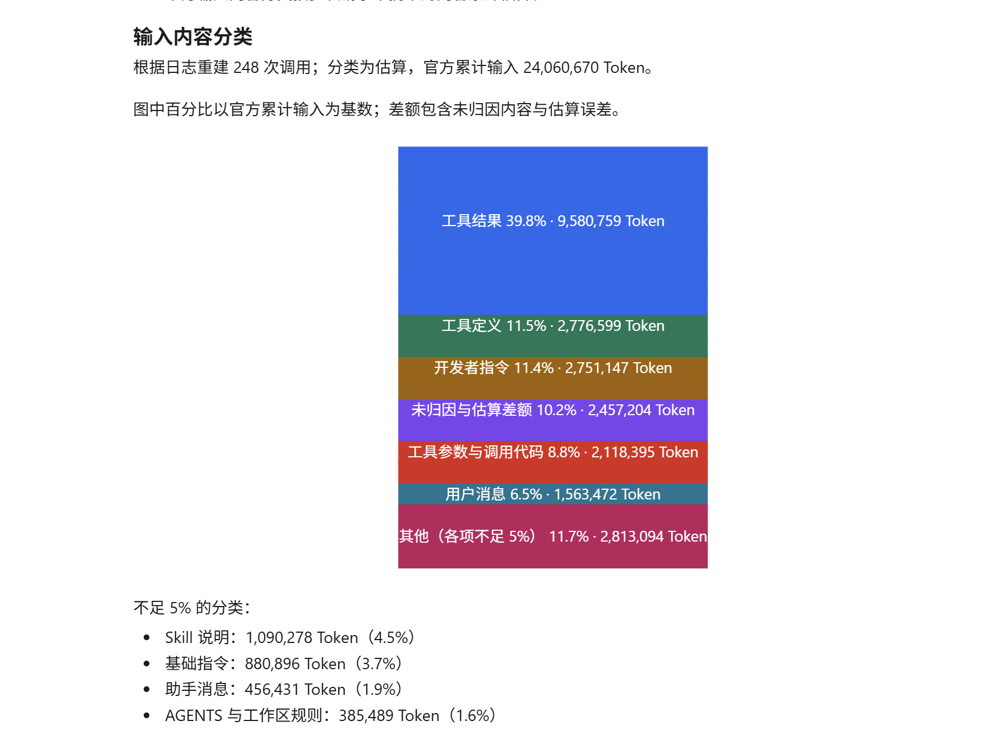

# Token Usage · Codex Token 分析插件

> 看清 Token 消耗在哪里，找到可以优化的上下文。

[它解决什么问题](#它解决什么问题) · [快速开始](#快速开始) · [怎么使用](#怎么使用)

Token Usage 是一个 Codex 插件。在聊天窗输入 `/usage-analyze`，就能分析当前会话或指定时间范围的本地 Token 用量。



## 它解决什么问题

| 你想知道什么 | 插件提供什么 |
|---|---|
| 消耗了多少 Token？ | 汇总输入、缓存输入和输出 Token |
| 输入主要来自哪里？ | 估算工具结果、工具定义、指令和消息等内容的累计占用 |
| 哪些工具返回的内容最多？ | 按文件读取、命令执行、网页检索等类别细分工具结果 |
| 哪个时间段或会话消耗最多？ | 按时间和会话展示输入用量 |
| 应该先优化什么？ | 根据可观测的输入内容给出排查建议 |

输入总量来自本地用量记录；各类内容占用根据日志重放估算，不是官方逐类计数。

## 快速开始

需要安装 Codex 和 Python 3，并确保终端可以通过 `PATH` 找到 `python`。

```bash
codex plugin marketplace add ynymhrb/token_usage && codex plugin add codex-context-optimizer@token-usage-local
```

这行先添加插件市场，再安装插件，需要在支持 `&&` 的终端中运行。

## 怎么使用

在 Codex 聊天输入框输入 `/usage-analyze`，选择 **Codex Context Optimizer: Usage Analyze** 并发送。默认分析当前会话，也可以附加范围：

```text
/usage-analyze
/usage-analyze 分析今天会话
/usage-analyze 全部历史
```
