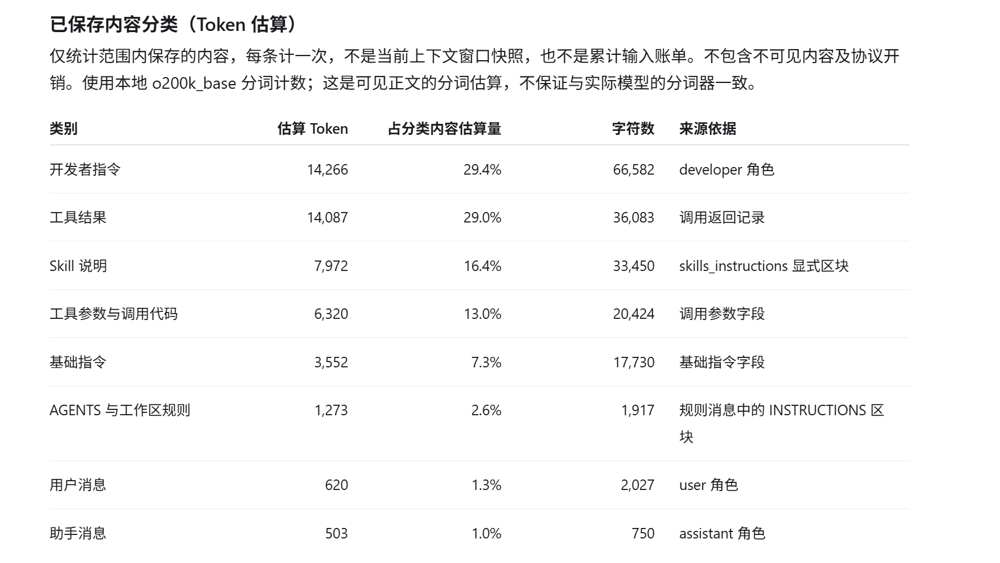

# tokenUsage

本地、脱敏、只读的 AI 会话 Token 诊断工具集合。

本项目不调用任何云端 API，也不修改原始会话数据，仅在本机读取 Claude Code / Codex 保存的 rollout，输出可归因、可审计的 Token 使用报告和优化建议。

## 功能模块

| 模块 | 说明 |
|------|------|
| `claude_session_token_profiler.py` | 分析 Claude Code 会话 JSONL，输出按请求、按角色的 cache / input / output Token 明细，并定位上下文增长来源。 |
| `codex_token/` | 本地 Codex Token 诊断包，支持 rollout 分析、上下文构成归因、实验计划与结果比较。 |
| `codex-context-optimizer/` | 本地 Codex 插件，通过受控 MCP 工具压缩大输出和重复输出，减少进入模型的上下文体积。 |

## 快速开始

环境要求：Python 3.11+，无第三方依赖。

### Claude Code 会话分析

```bash
python claude_session_token_profiler.py --session <session-id>
```

默认读取路径：`~/.claude/projects/**/<session-id>.jsonl`。

### Codex Token 分析

```bash
# 只读分析本地 Codex rollout
python -m codex_token analyze --sessions-root ~/.codex/sessions --format md

# 按保存的请求结构分析上下文构成
python -m codex_token context-breakdown --sessions-root ~/.codex/sessions --output context.json

# 从脱敏报告生成建议
python -m codex_token recommend report.json
```

### 上下文构成归因示例

`context-breakdown` 会读取 Codex 保存的 `*.llm_calls.jsonl` 请求结构，按静态指令、工具定义、消息、工具参数、工具结果等类别统计占比，并给出优先优化建议：



> 该图仅为展示效果。实际命令输出的分类口径与上表一致，但不会回显任何请求或工具正文；数值使用稳定 JSON 字符数作为结构占比代理，不是精确 Token 账单。

## 命令详解

### `python -m codex_token analyze`

- 仅在本机读取 Codex rollout。
- 默认输出脱敏 JSON，可用 `--format md` 输出 Markdown。
- 识别大工具输出、重复工具调用、上下文增长拐点、失败重试等模式。

### `python -m codex_token context-breakdown`

- 不读取 rollout 正文，只读取已保存的请求结构（`*.llm_calls.jsonl`）。
- 输出各类别字符数、占比、数据缺口和优化建议。
- 当前请求结构导出没有一对一 Token 使用记录，因此占比是**可比较的估算**，不是账单 Token。

### `python -m codex_token recommend`

- 只接受已脱敏的 JSON 报告，拒绝原始 JSONL。
- 基于报告中的事实和派生指标生成可解释的建议。

### `python -m codex_token experiment`

- `experiment plan experiments/token-optimization-v1.json`：仅生成实验计划，不执行。
- `experiment run` 必须显式传入 `--execute --budget-usd`，且首版没有随清单版本化的模型价格表，会拒绝执行，避免把 Token 上限误报为美元预算。

### Codex 上下文优化插件

安装 `codex-context-optimizer/` 到本地 Codex 插件目录并信任其 hooks 后，模型会通过 MCP 服务 `context_optimizer` 调用以下受控工具：

- `run_command`：运行参数数组命令，大输出会被压缩。
- `read_file`：读取工作区内文件，大内容会被压缩。

完整结果写入插件数据目录，模型只收到预算内的摘要；重复内容返回引用标签；输出会脱敏常见密钥、Bearer 凭据、GitHub 令牌、私钥块和数据库连接串。

## 运行测试

```bash
python -m unittest discover -s . -p "test_*.py"
```

## 安全与隐私

- 所有分析工具只读访问本机会话文件，不写回原始数据。
- `codex_token` 在生成报告前对会话 ID、模型名等标识符做哈希脱敏。
- `codex-context-optimizer` 在 MCP 边界对大输出脱敏，完整内容不落模型上下文。
- 项目不收集遥测，不访问云端。

## 项目结构

```
.
├── claude_session_token_profiler.py   # Claude Code Token 分析器
├── codex_token/                       # Codex Token 诊断包
│   ├── cli.py                         # 命令行入口
│   ├── adapter.py                     # rollout 解析适配
│   ├── context_attribution.py         # 上下文构成归因
│   ├── context_optimizer.py           # 上下文压缩核心
│   ├── detectors.py                   # 诊断规则
│   ├── experiments.py                 # 受控实验
│   ├── mcp_server.py                  # MCP 服务
│   ├── models.py                      # 数据模型
│   ├── privacy.py                     # 脱敏工具
│   ├── report.py                      # 报告生成
│   └── recommendations.py             # 建议生成
├── codex-context-optimizer/           # Codex 本地插件
│   ├── .codex-plugin/plugin.json
│   ├── .mcp.json
│   ├── hooks/pre_compact.py
│   ├── scripts/mcp_server.py
│   └── skills/context-optimizer/SKILL.md
├── docs/                              # 文档与截图
├── experiments/                       # 实验清单
├── scripts/                           # 辅助脚本
└── test_*.py                          # 单元测试
```

## 许可证

MIT
